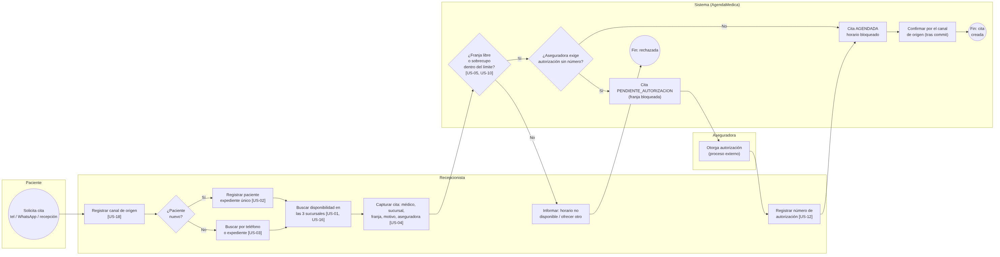
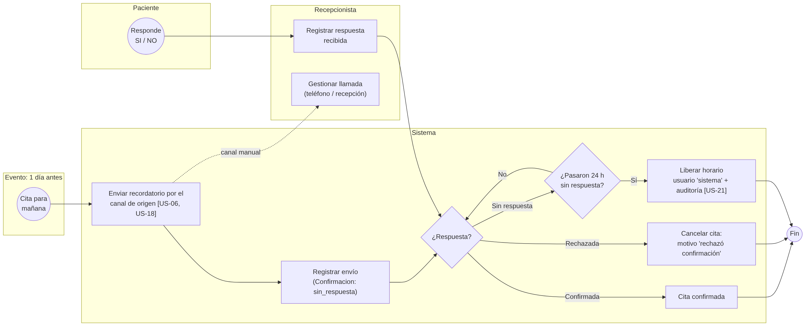
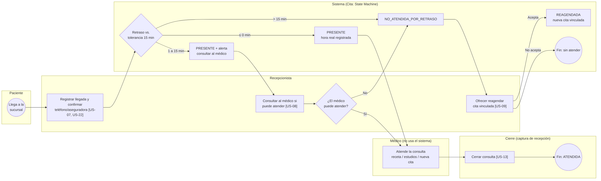
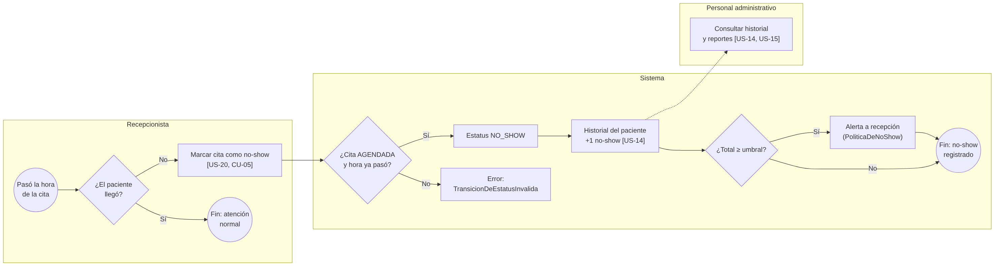
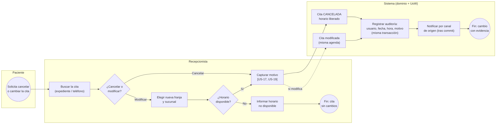
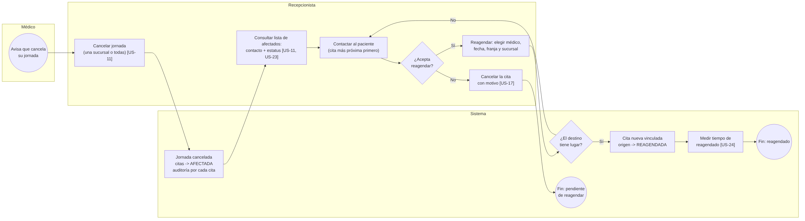

# BPMN del proceso — MediNova

El BPMN de la Unidad 2 ([`BPMN_Unidad2.pdf`](BPMN_Unidad2.pdf), 1 diagrama con 5 carriles: Paciente, Recepcionista, Médico, Aseguradora y Personal administrativo) cubría agendar, llegada, no-show y jornada cancelada. Para el PIA se **refinó y completó** en seis procesos por carril, uno por flujo, con cada tarea trazada a su historia de usuario. Los procesos que faltaban en U2 (cancelar/modificar cita y confirmación/liberación) se agregan, como pedía la corrección de alcance del informe de U3.

| Proceso | Diagrama | Eventos de inicio/fin | Gateways | Casos de uso / US |
|---|---|---|---|---|
| Agendar cita y bloquear horario | `bpmn/agendar.png` | Solicitud del paciente → cita creada / rechazada | ¿Paciente nuevo?, ¿franja libre o sobrecupo?, ¿exige autorización? | CU-01, US-01…05, 10, 12, 16, 18 |
| Confirmación y liberación a las 24 h | `bpmn/confirmacion.png` | Cita para mañana → confirmada / cancelada / liberada | ¿Respuesta?, ¿pasaron 24 h? | US-06, US-18, US-21 |
| Registrar llegada y atender | `bpmn/llegada.png` | Llegada del paciente → atendida / sin atender | Retraso vs. tolerancia, ¿el médico puede atender?, ¿acepta reagendar? | CU-02, US-07…09, 13, 22 |
| Marcar no-show | `bpmn/no-show.png` | Pasó la hora → no-show registrado | ¿Llegó?, ¿agendada y hora pasada?, ¿≥ umbral? | CU-05, US-14, US-20 |
| Cancelar o modificar cita | `bpmn/cancelar-modificar.png` | Solicitud del paciente → cambio con evidencia | ¿Cancelar o modificar?, ¿horario disponible? | CU-04, US-17, US-19 |
| Médico cancela su jornada | `bpmn/jornada.png` | Aviso del médico → reagendado / pendiente | ¿Acepta reagendar?, ¿el destino tiene lugar? | CU-03, US-11, US-23, US-24 |

Los diagramas fuente están en Mermaid (`bpmn/*.mmd`) y se exportan a PNG con `mmdc`. Los datos asociados (data objects) corresponden a: horarios por médico (jornadas), cita, lista de afectados, historial de auditoría y reporte consolidado.

