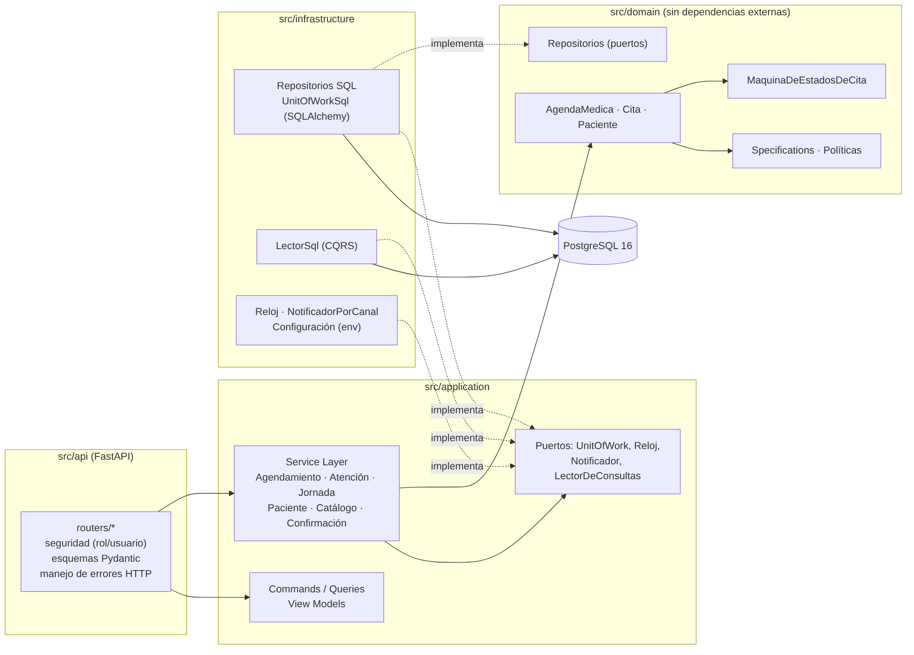

# Documento de decisiones técnicas

## 1. Vista general
Arquitectura en capas con la **regla de dependencia hacia el dominio** (ADR-001, ADR-007). Una prueba automática (`test_el_dominio_no_importa_infraestructura_ni_api`) la verifica.

| Capa | Carpeta | Contiene | Depende de |
|---|---|---|---|
| Dominio | `src/domain/` | Aggregates (`AgendaMedica`, `Paciente`), entidades (`Cita`, `Jornada`, `Medico`…), Value Objects, eventos, Specifications, State Machine, políticas, Domain Service (`Reagendador`), puertos de repositorio | nada |
| Aplicación | `src/application/` | Service Layer (un método = un caso de uso), Commands, Queries y View Models, puertos (`UnitOfWork`, `Reloj`, `Notificador`, `LectorDeConsultas`) | dominio |
| Infraestructura | `src/infrastructure/` | Repositorios y Unit of Work SQL (SQLAlchemy), `LectorSql`, notificador, relojes, configuración, seed | dominio, aplicación |
| API | `src/api/` | Routers REST, esquemas Pydantic, seguridad por rol, manejo de errores HTTP, composition root | aplicación, infraestructura |

## 2. Patrones y por qué
| Patrón | Dónde | Problema del negocio que resuelve |
|---|---|---|
| Domain Model + Aggregate | `AgendaMedica` | Citas duplicadas entre sucursales y sobrecupo por médico (N1, N5) |
| Value Object | `FranjaHoraria`, `Tolerancia`, `LimiteDeSobrecupo`, `Contacto`, `MotivoDeCambio`… | Reglas pequeñas y sin identidad (15 min, motivo obligatorio) |
| **Specification** | `especificaciones.py` | Combinar reglas de agendado (`HorarioLibre \| SobrecupoDisponible`) y probarlas aisladas |
| **State Machine** | `estados.py` | Ciclo de la cita con 9 estados; una transición inválida es imposible |
| Repository + Unit of Work | `repositorios.py`, `unit_of_work*.py` | Una transacción por caso de uso; auditoría y cita atómicas (T5) |
| Service Layer | `*_service.py` | Casos de uso que coordinan sin decidir reglas |
| CQRS básico | `LectorSql` + View Models | Pantallas que juntan sucursales sin cargar agregados |
| Domain Events | `eventos.py` | Auditoría y notificación desacopladas |
| Strategy | `PoliticaDeNoShow`, `PoliticaDeAutorizacion` | Reglas que dirección/aseguradoras cambian (ADR-005) |
| Adapter + inversión de dependencias | `NotificadorPorCanal`, repositorios SQL, relojes | Cambiar WhatsApp o la BD sin tocar el dominio |
| Optimistic Locking | columna `agendas.version` | Dos recepcionistas sobre la misma franja (ADR-002) |
| Composition Root | `api/composicion.py` | Único lugar donde se conectan puertos y adaptadores |

## 3. SOLID demostrable
| Principio | Evidencia en el código |
|---|---|
| **S** | Tres servicios por razón de cambio (`AgendamientoService`, `AtencionService`, `JornadaService`) más `PacienteService`, `CatalogoService`, `ConfirmacionService` y lectores aparte. La `Cita` controla sus transiciones y `AgendaMedica` solo lo que involucra a varias citas. |
| **O** | Nueva política de no-show o de autorización = nueva clase que implementa la interfaz; ningún caso de uso cambia. Nueva regla de agendado = nueva `Especificacion`. |
| **L** | `Notificador.enviar` siempre devuelve `ResultadoDeNotificacion` (nunca lanza por su canal); los repositorios SQL cumplen el mismo contrato que usa el dominio; `SinSancionPorNoShow` y `AlertaPorUmbralDeNoShows` son intercambiables. |
| **I** | Repositorios pequeños por Aggregate; `UnitOfWork` solo expone `confirmar`; lectores de consulta separados del modelo de escritura. |
| **D** | Los servicios reciben `Reloj`, `UnitOfWork`, políticas y `Notificador` por constructor; el dominio recibe `ahora` como parámetro. Las pruebas de 14/15/16 minutos usan `RelojFijo` sin esperar. |

## 4. Decisiones transversales
- **Concurrencia.** Versión optimista por agenda; el conflicto se traduce a `HorarioNoDisponible` (HTTP 409). Probado en SQLite y en PostgreSQL 16.
- **Transacciones.** `with uow:` por caso de uso; el cierre de consulta con nueva cita o el reagendado entre dos agendas son una sola transacción (todo o nada).
- **Auditoría.** Se escribe en `confirmar()` antes del commit; las notificaciones, después.
- **Tiempo.** Fechas locales de la clínica sin zona (`America/Monterrey`), coherentes con las franjas; el reloj es inyectable y, solo en demos, simulable (`RELOJ_SIMULABLE`).
- **Errores.** Jerarquía `ErrorDeDominio` en lenguaje del negocio → 404 (no encontrado), 409 (conflicto o transición inválida), 422 (datos o franja fuera de jornada), 403 (rol).
- **Seguridad.** Rol y usuario por cabeceras (`X-Rol`, `X-Usuario`); solo `recepcion` agenda y cancela. La autenticación real queda fuera de alcance (BRD D12).
- **Configuración.** Todo por variables de entorno (`.env.example`), sin secretos en el repositorio (12-Factor).
- **Despliegue.** Imagen Docker multi-etapa (`app`, `tests`), `docker-compose.yml` con PostgreSQL + app + pruebas, `render.yaml` y job de despliegue en GitHub Actions; Swagger UI se sirve desde la propia app.

## 5. Diagramas
- [Mapa de dominio](diagramas/mapa-dominio.png) · [Clases: dominio](diagramas/clases-dominio.png) · [Clases: aplicación e infraestructura](diagramas/clases-aplicacion.png) · [Estados de la cita](diagramas/estados-cita.png)
- [Secuencia: agendar](diagramas/secuencia-agendar.png) · [Secuencia: llegada](diagramas/secuencia-llegada.png) · [Secuencia: jornada cancelada](diagramas/secuencia-jornada.png)
- [Modelo relacional](diagramas/er.png)
Los diagramas están en Mermaid (`*.mmd`) y el de estados se **genera desde la tabla de transiciones del código** (`MaquinaDeEstadosDeCita.a_mermaid()`), por lo que no puede divergir de él.

## 6. Limitaciones conocidas
- WhatsApp es un adaptador simulado; la API real requiere credenciales de MediNova.
- Sin autenticación corporativa ni migraciones (Alembic) todavía.
- La política de no-shows (D3) es una propuesta del equipo pendiente de aprobación de dirección.
